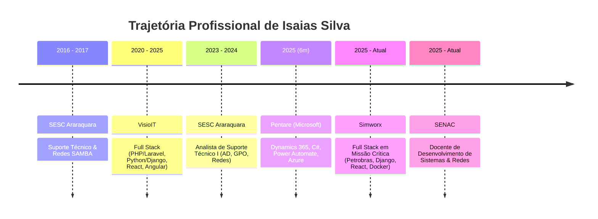

<div align="center">

# 👨‍💻 Isaias Silva
### **Senior Full Stack Developer & Docente de Tecnologia**

[](https://linkedin.com/in/isaiasvasilva)
[](https://github.com/isaiasvas)
[](mailto:isaias@visioit.com.br)
[](https://isaiasvas.github.io/)

<p align="center">
  <em>Desenvolvimento de sistemas web escaláveis, microsserviços, APIs robustas e soluções corporativas de missão crítica com PHP, Python e JavaScript, unindo rigor de engenharia e educação tecnológica.</em>
</p>

</div>

---

## 📖 Sumário

1. [Sobre Isaias Silva](#-sobre-isaias-silva)
   - [Perfil Profissional](#-perfil-profissional)
   - [Principais Experiências](#-principais-experiências)
   - [Formação Acadêmica](#-formação-acadêmica)
   - [Tech Stack & Domínios](#-tech-stack--domínios)
2. [Sobre a Construção Deste Portfólio](#-sobre-a-construção-deste-portfólio)
   - [Objetivo do Projeto](#-objetivo-do-projeto)
   - [Diretrizes Visuais e Filosofia de Design](#-diretrizes-visuais-e-filosofia-de-design)
   - [Destaques de Engenharia e UX](#-destaques-de-engenharia-e-ux)
   - [Arquitetura e Stack do Frontend](#-arquitetura-e-stack-do-frontend)
   - [Estrutura de Diretórios](#-estrutura-de-diretórios)
3. [Guia de Execução Local](#-guia-de-execução-local)
4. [Publicação e Deploy no GitHub Pages](#-publicação-e-deploy-no-github-pages)
5. [Contato e Redes](#-contato-e-redes)

---

## 👤 Sobre Isaias Silva

### 🌟 Perfil Profissional

Sou **Desenvolvedor Full Stack** com trajetória sólida em tecnologia iniciada em **2016** e atuação profissional contínua registrada desde **2020**. 

Minha carreira é marcada pela construção de sistemas corporativos complexos, portais de alta disponibilidade e microsserviços para setores exigentes, incluindo prestação de serviços para operações da **Petrobras**.

Possuo ampla experiência em desenvolvimento backend orientado a objetos com **PHP** (utilizando **Laravel**, **WordPress** e **Drupal**) e **Python** (com **Django** e **Django REST Framework**), além de interfaces frontend reativas e responsivas com **JavaScript**, **React** e **Angular**. No ecossistema corporativo, atuo com **C#**, **Microsoft Dynamics 365 (CRM)**, automações com **Power Automate** e nuvem **Microsoft Azure**.

Também atuo como **Docente de Informática e Desenvolvimento de Sistemas no SENAC**, ministrando disciplinas que abrangem desde infraestrutura de redes e lógica de programação até modelagem de software, POO, banco de dados, segurança e arquitetura de sistemas — conectando as exigências reais do mercado de trabalho com a formação de novos talentos.

---

### 💼 Principais Experiências



- **Docente de Informática — SENAC** *(2025 – Atual | Presencial | Araraquara - SP)*  
  Aulas nas trilhas técnicas de Desenvolvimento de Sistemas (modelagem, POO, banco de dados, UX/UI, versionamento com Git, testes e segurança), Infraestrutura de Redes e Programação de Jogos Digitais (Unity).
- **Desenvolvedor Full Stack — Simworx** *(2025 – Atual | Home Office)*  
  Atuação em projeto de missão crítica para operações da **Petrobras**. Desenvolvimento de back-end em Python/Django para ambientes embarcados, interfaces frontend em React integradas a APIs RESTful, conteinerização com Docker e esteiras CI/CD com Jenkins.
- **Desenvolvedor Full Stack — Pentare (Parceiro Microsoft)** *(2025 | Home Office)*  
  Customização avançada do módulo de CRM do Microsoft Dynamics 365 em C# (Plugins, Web APIs, WebApps), orquestração de fluxos de negócio com Power Automate, Azure Web Apps, Azure Key Vault e CI/CD via Azure DevOps.
- **Desenvolvedor Full Stack — VisioIT** *(2020 – 2025 | Home Office)*  
  Criação e manutenção de sistemas corporativos e portais de conteúdo em PHP (Laravel, Drupal, WordPress) e Python (Django), com frontends em React e Angular, integrações RESTful, Docker e testes de API com Postman.
- **Analista de Suporte Técnico I / Estagiário — SESC Araraquara** *(2023 – 2024 e 2016 – 2017)*  
  Administração de Active Directory, GPO, redes corporativas, servidores SAMBA e infraestrutura de TI.

---

### 🎓 Formação Acadêmica

- **Pós-Graduação Lato Sensu em Desenvolvimento Full Stack** — *Estácio de Sá* (2024 – 2025 | EAD)  
  *Foco em microsserviços, computação em nuvem, padrões de arquitetura e segurança web.*
- **Bacharelado em Sistemas de Informação** — *Universidade de Araraquara (UNIARA)* (2015 – 2022 | Presencial)  
  *Fundamentos de Ciência da Computação, algoritmos, modelagem relacional, redes e governança de TI.*

---

### 🧰 Tech Stack & Domínios

| Domínio | Tecnologias & Ferramentas |
| :--- | :--- |
| **Backend** | PHP (POO), Laravel, Python, Django, Django REST Framework, C#, Java, Spring Boot, .NET, WordPress, Drupal 9 |
| **Frontend** | JavaScript (ES6+), React, Angular, Tailwind CSS, TypeScript, HTML5, CSS3, Responsive Design |
| **Bancos de Dados** | PostgreSQL, MySQL, SQL, Redis, Modelagem Relacional, Migrations & ORMs |
| **APIs & Arquitetura** | RESTful APIs, Microsserviços, Clean Architecture, MVC, Webhooks, Protocolo MQTT (IoT) |
| **DevOps & Ferramentas** | Docker, Git, GitHub, Jenkins, Azure DevOps (Repos, CI/CD), Postman, Linux CLI, Jira |
| **Plataforma Microsoft** | Dynamics 365 (CRM), Power Automate, PowerApps, Azure (Web Apps, Key Vault, Application Insights) |
| **Infra & Redes** | Linux, Active Directory (AD), GPO (Políticas de Grupo), Servidores SAMBA, Switches & Roteamento |

---

## 🌐 Sobre a Construção Deste Portfólio

Este website foi projetado e construído sob medida com arquitetura modular, clean code, padrões de acessibilidade (WCAG), otimização para SEO e suporte completo a deploy contínuo no **GitHub Pages**.

### 🎯 Objetivo do Projeto
O portfólio reúne em uma única experiência web:
1. **Currículo Online Completo:** Informações autênticas de histórico profissional, formação e habilidades técnicas.
2. **Central de Projetos Arquiteturais:** Exibição estruturada de 10 projetos planejados (Django, Laravel e Spring Boot) com filtros instantâneos e modais de arquitetura de software.
3. **Hub de Links Profissionais & Contato:** Acesso direto a GitHub, LinkedIn, cópia rápida de e-mail com toast e download do currículo oficial em PDF.
4. **Demonstração de Rigor de Engenharia:** Código limpo, componentização de responsabilidade única, desacoplamento total de dados e zero dependências redundantes.

---

### 🎨 Diretrizes Visuais e Filosofia de Design

Inspirado nas melhores referências de design editorial contemporâneo de engenharia de software:
- **Estética Minimalista & Tecnológica:** Uso amplo de espaço negativo (white space), tipografia marcante e contraste preciso.
- **Sem Clichês:** Foram eliminadas barras fictícias de porcentagem de conhecimento (ex: *PHP 95%*), efeitos exagerados de "terminal hacker" ou excesso de neon. O foco é clareza, maturidade e sofisticação.
- **Tema Claro & Escuro (Light/Dark Mode):**
  - *Light Mode:* Superfícies em cinza suave e branco (`#ffffff`, `#f8fafc`), tipografia escura (`#0f172a`), bordas sutis.
  - *Dark Mode:* Fundo profundo (`#080c14`), superfícies de cards (`#0f1726`), texto de alto contraste (`#f8fafc`).
  - *Destaque:* Cor de acento Azul Royal/Indigo (`#0c8ee9`), comunicando confiabilidade e engenharia de software.
- **Transições e Microinterações:** Animações otimizadas com GPU (`transform` e `opacity`), transições suaves de elevação (`translateY(-4px)`), hover dinâmico em cards e rotação suave de especialidades na Hero Section.
- **Respeito ao Usuário:** Suporte nativo à diretiva `@media (prefers-reduced-motion)` para desativar ou mitigar animações para usuários sensíveis a movimento.

---

### ⚡ Destaques de Engenharia e UX

- **🌓 Alternador de Tema Inteligente sem FOUC:** O script inline no `<head>` do `index.html` inspeciona o `localStorage` e a preferência do sistema operacional (`prefers-color-scheme`) antes da primeira pintura da tela, impedindo flashes de tema incorreto.
- **📂 Desacoplamento Total de Dados (`src/data/`):** Todos os textos, experiências, projetos e habilidades estão isolados em arquivos de dados (`profile.js`, `experience.js`, `projects.js`, `skills.js`, `education.js`), permitindo fácil manutenção sem alterar componentes de interface.
- **🗂️ 10 Projetos com Filtros e Modais de Arquitetura:**
  - **4 Projetos Django:** *SaaS de Gestão Empresarial*, *Plataforma IoT*, *Sistema de Service Desk*, *Plataforma LMS*.
  - **4 Projetos Laravel:** *ERP Comercial*, *Help Desk com SLA*, *Plataforma de Eventos (QR Code)*, *SaaS de Contratos*.
  - **2 Projetos Spring Boot:** *E-commerce em Microsserviços*, *Sistema Financeiro / Banking API*.
  - Modais detalham: **O Desafio/Problema**, **Objetivo**, **Arquitetura Planejada**, **Stack Completa** e **Checklist de Funcionalidades**.
- **📄 Download e Geração do Currículo PDF:** O projeto inclui um script utilitário em Node.js (`scripts/generate-pdf.js`) que compila o currículo oficial diretamente em `public/curriculo-isaias-silva.pdf`, permitindo download instantâneo e visualização em nova aba.
- **🔍 SEO e Structured Data Completos:**
  - Meta tags para OpenGraph (Facebook, LinkedIn) e Twitter Cards.
  - Dados Estruturados em **JSON-LD Schema.org** (`@type: "Person"`).
  - Arquivos `robots.txt` e `sitemap.xml` para indexação ótima por mecanismos de busca.
- **📱 Mobile-First:** Totalmente responsivo e testado para resoluções de **320px**, **375px**, **768px**, **1024px**, **1440px** e **1920px+**, com menu hamburger com navegação por teclado e bloqueio de scroll quando ativo.

---

### 💻 Arquitetura e Stack do Frontend

```
React 18 + Vite (Bundle Estático Otimizado)
 ├── Tailwind CSS (Design System com tema Dark por classe)
 ├── Lucide React (Biblioteca de Ícones Leve e Consistente)
 ├── PostCSS + Autoprefixer
 ├── Custom Hooks (useTheme, useActiveSection)
 └── GitHub Actions (Pipeline CI/CD com Pages Artifacts)
```

---

### 📂 Estrutura de Diretórios

```
portfolio/
├── .github/
│   └── workflows/
│       └── deploy.yml              # Pipeline CI/CD para deploy no GitHub Pages
├── public/
│   ├── curriculo-isaias-silva.pdf  # Currículo oficial em PDF para download
│   ├── favicon.svg                 # Favicon vetorial com o monograma IS
│   ├── robots.txt                  # Diretivas de indexação SEO
│   └── sitemap.xml                 # Sitemap XML do site
├── scripts/
│   └── generate-pdf.js             # Gerador do PDF a partir dos dados estruturados
├── src/
│   ├── components/                 # Componentes reutilizáveis
│   │   ├── About.jsx               # Seção Sobre Mim e métricas de carreira
│   │   ├── Contact.jsx             # Seção de contato com cópia de e-mail e links
│   │   ├── Education.jsx           # Seção de Formação Acadêmica
│   │   ├── Experience.jsx          # Timeline vertical de experiências
│   │   ├── Footer.jsx              # Rodapé com ano dinâmico em JavaScript
│   │   ├── Header.jsx              # Navbar fixa com blur, menu mobile e toggle
│   │   ├── Hero.jsx                # Hero section com rotador de tecnologias
│   │   ├── ProjectCard.jsx         # Card do projeto com capas abstratas
│   │   ├── ProjectModal.jsx        # Modal de detalhes de arquitetura do projeto
│   │   ├── Projects.jsx            # Grid e filtros de projetos
│   │   ├── SectionHeading.jsx      # Título padronizado com badge editorial
│   │   ├── Skills.jsx              # Tech Stack categorizada por domínios
│   │   ├── SocialIcons.jsx         # Ícones vetoriais do GitHub e LinkedIn
│   │   ├── ThemeToggle.jsx         # Alternador de tema Claro / Escuro
│   │   └── Toast.jsx               # Notificação de feedback acessível
│   ├── data/                       # Camada de dados centralizada
│   │   ├── education.js            # Dados acadêmicos (Pós e Bacharelado)
│   │   ├── experience.js           # Histórico profissional cronológico
│   │   ├── profile.js              # Informações pessoais, bio e contatos
│   │   ├── projects.js             # 10 projetos estruturados
│   │   └── skills.js               # Categorias e matriz de habilidades
│   ├── hooks/                      # Hooks customizados
│   │   ├── useActiveSection.js     # Destaque dinâmico do item ativo no menu
│   │   └── useTheme.js             # Controle e persistência do tema Claro/Escuro
│   ├── styles/
│   │   └── index.css               # Estilos base, grid patterns e scrollbar
│   ├── App.jsx                     # Componente raiz da aplicação
│   └── main.jsx                    # Ponto de entrada React
├── index.html                      # HTML com SEO, fontes e Schema.org JSON-LD
├── vite.config.js                  # Configuração do Vite com base relativa './'
├── tailwind.config.js              # Configuração de cores, fontes e animações
├── postcss.config.js               # Configuração do PostCSS
├── package.json                    # Dependências e scripts do projeto
└── README.md                       # Documentação completa do projeto
```

---

## 🛠️ Guia de Execução Local

### Pré-requisitos
- **Node.js** v18+ (recomendado Node 20 LTS)
- **NPM** v9+

### 1. Clonar o Repositório
```bash
git clone https://github.com/isaiasvas/isaiasvas.github.io.git
cd isaiasvas.github.io
```

### 2. Instalar as Dependências
```bash
npm install
```

### 3. Executar o Servidor de Desenvolvimento
```bash
npm run dev
```
Abra o navegador em: `http://localhost:3000`

### 4. Gerar o Build de Produção
```bash
npm run build
```
Os arquivos otimizados e minificados serão gerados na pasta `dist/` (tamanho compactado: ~81 kB).

### 5. Pré-visualizar o Build Localmente
```bash
npm run preview
```

### 6. Gerar o Currículo PDF Novamente
```bash
npm run generate-pdf
```

---

## 🚀 Publicação e Deploy no GitHub Pages

O projeto já está 100% configurado com **GitHub Actions** em `.github/workflows/deploy.yml` e com base relativa em `vite.config.js` (`base: './'`), funcionando perfeitamente como **User Page** em `https://isaiasvas.github.io/`.

### Passo a Passo para Publicar:

1. Crie o repositório no seu GitHub com o nome exato `isaiasvas.github.io`.
2. Conecte seu repositório local e envie os commits:
   ```bash
   git remote set-url origin https://github.com/isaiasvas/isaiasvas.github.io.git
   git push -u origin main
   ```
3. Acesse o seu repositório no GitHub:
   - Vá na aba **Settings** > **Pages**.
   - Em **Build and deployment** > **Source**, selecione a opção **GitHub Actions**.
4. Pronto! A action será disparada automaticamente a cada `git push` e publicará o portfólio no GitHub Pages em poucos segundos.

---

## 📬 Contato e Redes

Fique à vontade para entrar em contato para novas oportunidades, consultoria técnica ou projetos:

- 📧 **E-mail:** [isaias@visioit.com.br](mailto:isaias@visioit.com.br)
- 💼 **LinkedIn:** [linkedin.com/in/isaiasvasilva](https://linkedin.com/in/isaiasvasilva)
- 🐙 **GitHub:** [github.com/isaiasvas](https://github.com/isaiasvas)
- 📍 **Localização:** Araraquara – SP, Brasil

---

<div align="center">
  <sub>Desenvolvido com foco em engenharia, performance e design. © 2025 Isaias Silva.</sub>
</div>
